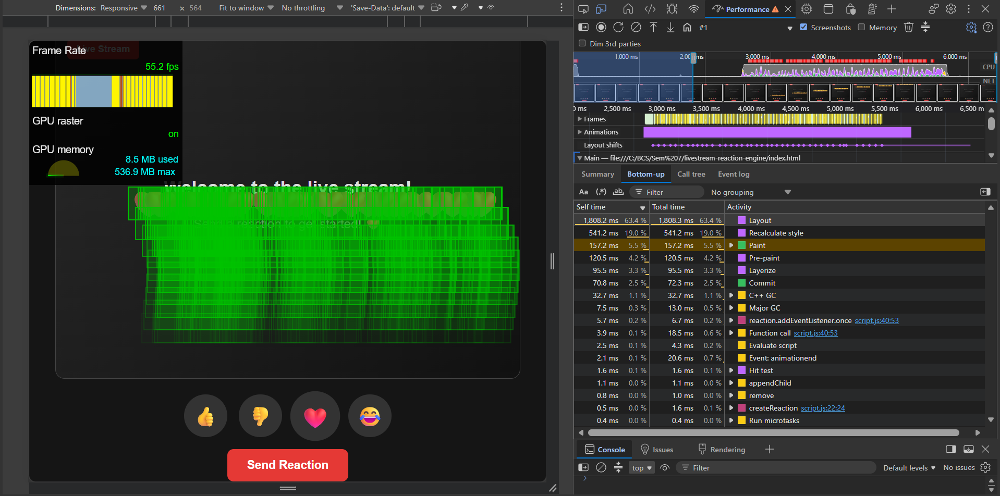
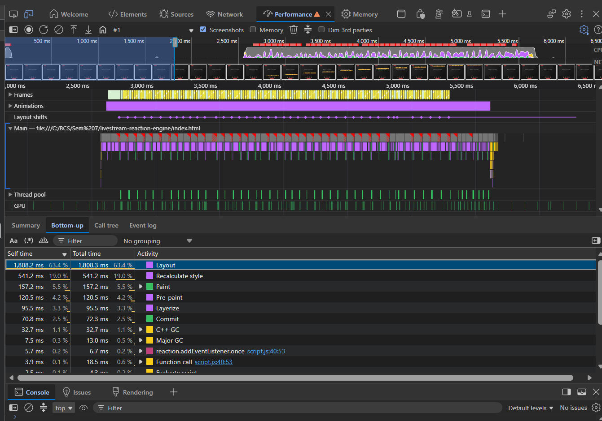
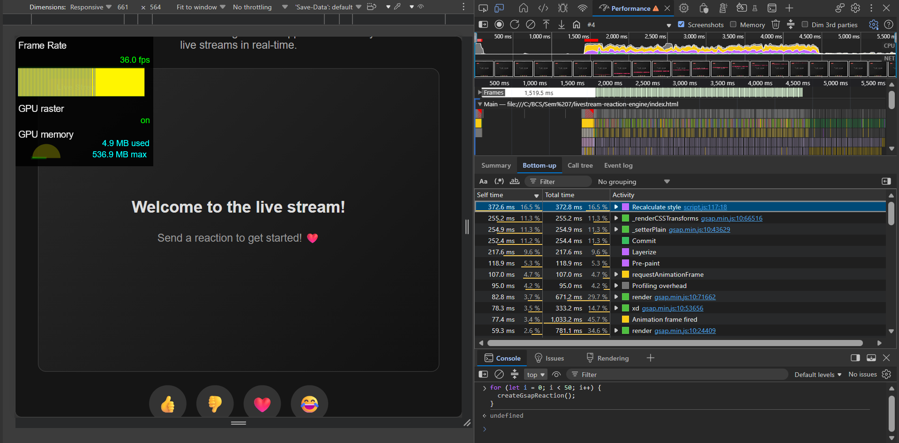

# Livestream Reaction Engine — Submission

## 1. Setup & Running Instructions

1. Download or extract the project folder.
2. Open `index.html` in a modern web browser.
3. Select a reaction using one of the available reaction buttons.
4. Click **Send Reaction** to display a floating reaction.
5. Use the Animation Mode selector to switch between Phase 1 (CSS) and Phase 2 (GSAP).
6. In Phase 2, use the animation speed slider to adjust the playback speed of active reactions.

**Requirements:**
- A modern web browser.
- An internet connection to load the GSAP library through its CDN.

## 2. Phase 1: CSS Keyframes Analysis

**Paint Flashing Screenshot:**

**Performance Profile Screenshot:**

**Observations:**

- **Paint Flashing:** During high-concurrency reaction spawning, green flashing appeared across almost half of the livestream stage. The green boxes closely followed the reactions' movement paths, forming a line as multiple reactions moved upwards. This indicates repeated repainting of areas affected by the animated reactions.

- **Main Thread Activity:** The Event Log showed repeated Layout, Recalculate Style, Pre-paint and Paint events while the CSS reactions were active. This indicates that the browser continued performing rendering-related work during the animation. Since the CSS keyframes animate layout-related properties such as bottom, margin-left and font-size, these animations can trigger additional layout and rendering calculations.

## 3. Phase 2: GSAP & Composited Rendering Analysis

**Performance Profile Screenshot:**

**Observations:**

- **Flame Chart and Frame Rate:** Compared with the CSS-mode retest, the GSAP recording showed considerably less Layout activity (36.6 ms compared with 1,880.3 ms) and less Painting time (132 ms compared with 307 ms). However, the FPS reading in the captured snapshots was lower in the GSAP recording (38.4 FPS compared with 57.0 FPS). These results show that reducing layout and painting work does not necessarily guarantee a higher frame rate in every recording.

- **Paint Invalidation Areas:** During the GSAP test with 50 reactions, no noticeable green flashing was observed while the reactions were moving upwards. However, when a second batch of 50 reactions was spawned consecutively, a row of green flashing areas appeared below the stage during spawning. This suggests that although GSAP's transform-based animations reduced repainting during movement, some painting activity still occurred when new reaction elements were added to the DOM.

## 4. Architectural Reflection

* **Runtime Control & Developer Experience:** CSS keyframes provide a straightforward way to define animations using predefined rules. However, making changes to an animation while it is running can be more difficult because the animation behaviour is mainly controlled through CSS. In comparison, GSAP provides greater programmatic control through timelines. In this project, GSAP allowed the playback speed of active reactions to be adjusted using the speed slider without restarting their animations. This makes it easier to manage and modify animation behaviour dynamically.

* **Pipeline Considerations:** If the application needed to dynamically tint, re-theme or modify reaction assets based on user preferences, programmatic vector manipulation would offer greater flexibility than using pre-rendered raster image sequences. Vector assets can be modified through code, allowing properties such as colour, shape and appearance to be changed at runtime. Raster image sequences consist of pre-rendered frames, so changing their appearance would require additional image processing or preparing alternative assets. Therefore, vector-based assets would be more suitable for applications that require frequent visual customisation.
